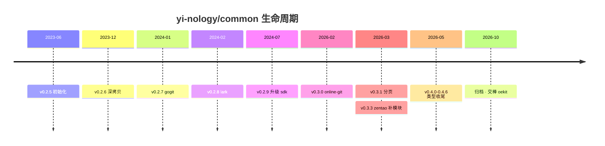

# common

> [!IMPORTANT]
> **本仓库已归档，不再维护。后续由 [`oekit`](https://github.com/oekit) 接档。**
>
> Go 工具集能力已迁移到 [Open Easy Kit · oekit](https://github.com/oekit)（23 个独立发版的模块：微工具 / 日志 / 追踪 / 注册发现 / Hertz / Kitex 生态）。
> 文档站：[oekit.github.io](https://oekit.github.io) · 组织主页：[github.com/oekit](https://github.com/oekit)
>
> 本仓库仅作历史留档，请勿再依赖其中的代码。

---

这是我在学习过程中的一些总结，包括一些基础知识、常见问题的解决方法、工具的使用方法等等。

## 存在时间轴

依据仓库 tag 记录（`v0.2.5` → `v0.4.6`）。建仓于 **2023-06-19**，归档于 **2026-10**。

| 时间 | Tag | 节点 |
|---|---|---|
| 2023-06-19 | [`v0.2.5`](https://github.com/yi-nology/common/releases/tag/v0.2.5) | 初始化 |
| 2023-12-13 | [`v0.2.6`](https://github.com/yi-nology/common/releases/tag/v0.2.6) | 增加数据深拷贝 |
| 2024-01-03 | [`v0.2.7`](https://github.com/yi-nology/common/releases/tag/v0.2.7) | 更新 gogit |
| 2024-02-17 | [`v0.2.8`](https://github.com/yi-nology/common/releases/tag/v0.2.8) | 增加 lark |
| 2024-07-18 | [`v0.2.9`](https://github.com/yi-nology/common/releases/tag/v0.2.9) | 升级 sdk |
| 2026-02-25 | [`v0.3.0`](https://github.com/yi-nology/common/releases/tag/v0.3.0) | 增加 online-git（沉寂约 19 个月后重启） |
| 2026-03-10 | [`v0.3.1`](https://github.com/yi-nology/common/releases/tag/v0.3.1) | zentao 列表接口分页 |
| 2026-03-16 | [`v0.3.3`](https://github.com/yi-nology/common/releases/tag/v0.3.3) | zentao 补齐 cases / feedbacks / testtasks / tickets |
| 2026-05-07 | [`v0.4.0`](https://github.com/yi-nology/common/releases/tag/v0.4.0) → [`v0.4.6`](https://github.com/yi-nology/common/releases/tag/v0.4.6) | zentao SDK 类型兼容收尾，当天连发 7 个版本 |
| 2026-10-17 | — | 归档，交棒 [`oekit`](https://github.com/oekit) |

## 模块概览（历史快照）

| 目录 | 说明 |
|---|---|
| `utils/` | 通用工具包（xjson / xtime / xnet / xlogger …） |
| `tools/` | 任务调度、编码等工具 |
| `biz/` | 业务侧封装（zentao / git / identity …） |
